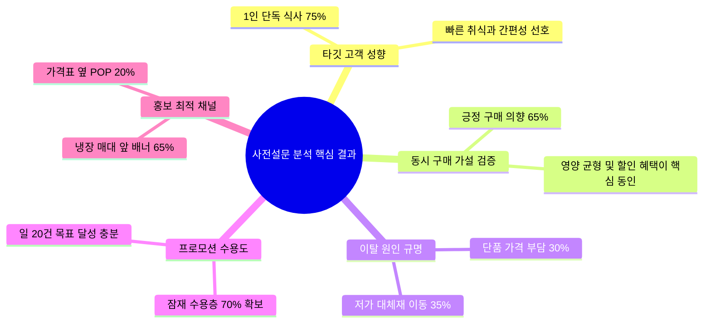
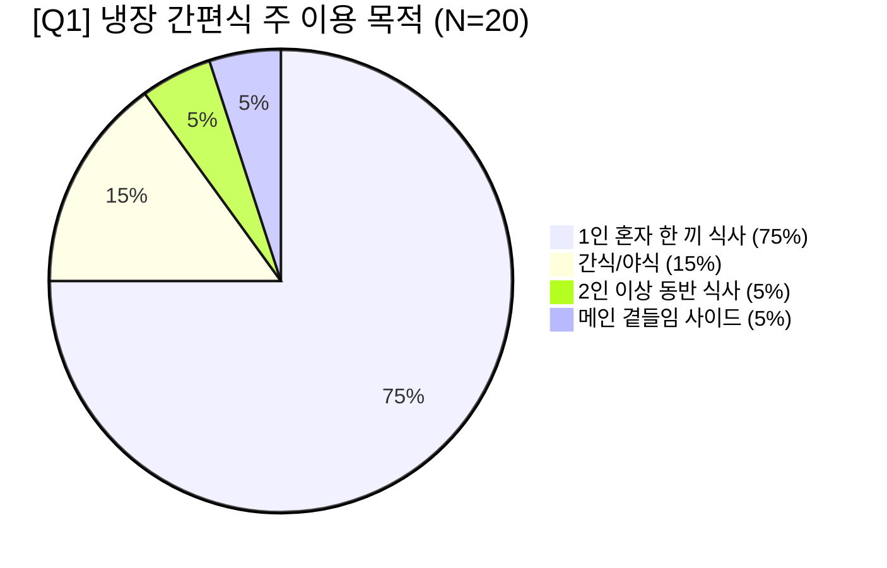

# [분석 보고서] 센트럴점 냉장 간편식 프로모션 사전 고객 설문조사 분석 결과

**문서 번호:** REPORT-20261014-01  
**작성 일자:** 2026년 10월 14일  
**대상 점포:** 센트럴점 (테스트베드 시범 점포)  
**분석 대상:** 구글 설문지 응답 데이터 (`[센트럴점] 냉장 간편식 프로모션 사전 고객 설문조사(응답).xlsx`, N=20)  
**연계 기획안:** 센트럴점 최종 프로모션 기획안 「골라 담는 한 끼, 함께 사면 할인」  

---

## 1. 설문조사 배경 및 목적

### 1.1 배경
* **매출 감소 문제**: 센트럴점의 전체 매출은 비교기간 동안 +1.28% 소폭 증가했으나, 기획 대상인 **냉장 간편식 3종(훈제오리 샐러드랩, 한끼 소불고기덮밥, 매콤 닭갈비볶음밥)의 매출은 합계 566,100원(-5.41%) 급감**함.
* **프로모션 기획**: 14일간 샐러드랩 1개 + 밥류 1개 동시 구매 시 500원(또는 10%) 즉시 할인 혜택을 제공하는 묶음 프로모션 기획 수립.
* **사전 검증 필요성**: 기획안에 명시된 *"영수증별 구매 내역이 없어 실제 동시 구매 수요는 미확인"* 상태였던 가설을 실증적으로 사전 검증하고, 한정된 예산(최대 20만 원: 할인 14만 원, 홍보 6만 원)의 효율적 집행 방안을 도출하고자 함.

### 1.2 조사 개요
* **조사 기간**: 2026년 10월
* **표본 크기**: 총 20명 (센트럴점 냉장 간편식 코너 실제 방문 고객)
* **조사 채널**: Google Form 모바일 설문조사

---

## 2. 핵심 분석 요약 (Executive Summary)

1. **가설 검증 완료 (동시 구매 의향 65%)**: 샐러드랩과 밥류를 함께 구매할 의향이 65%에 달해 묶음 프로모션의 잠재 수요가 탄탄함이 입증되었습니다.
2. **핵심 타깃 정의 (1인 단독 식사 75%)**: 2인 이상 나눔 식사(5%)보다 '1인 가구/직장인의 한 끼 해결'이 절대 다수입니다.
3. **매출 감소 원인 (초저가 대체재 이동 및 가성비 저항 65%)**: 품질 불만(25%)보다는 삼각김밥·라면 등 저가 간편식 대체(35%) 및 가격 부담(30%)이 주원인이었습니다.
4. **프로모션 성공 가능성 (잠재 수요 70%)**: 적극 구매 의향 45% + 유보층 25%로, 일일 20건(14일간 280건) 목표 달성 가능성이 매우 높습니다.
5. **홍보 집중처 (냉장 매대 집중도 85%)**: 매대 앞(65%)과 가격표 옆(20%)이 압도적이므로, 출입구 배너를 생략하고 냉장 쇼케이스 연출에 예산 6만 원을 전액 투입해야 합니다.

---

## 3. 문항별 상세 분석 데이터

### [문항 1] 냉장 간편식 주 이용 목적
> **Q1. 고객님께서 센트럴점에서 냉장 간편식(도시락, 덮밥, 샐러드랩 등)을 구매하실 때 주로 어떤 목적으로 이용하십니까?**

| 순위 | 응답 항목 | 응답자 수 | 응답 비율 | 시사점 |
| :---: | :--- | :---: | :---: | :--- |
| **1** | **혼자 빠르게 해결하는 점심/저녁 식사 (1인 한 끼)** | **15명** | **75.0%** | **핵심 타깃**. 간편성, 신속성, 1인 맞춤 포장 선호 |
| 2 | 식사 외 가벼운 간식이나 야식 | 3명 | 15.0% | 늦은 시간대 단품 스낵 수요 |
| 3 | 동료·가족과 함께 나눠 먹는 식사 (2인 이상) | 1명 | 5.0% | 다인 식사 목적은 극소수 |
| 4 | 메인 식사에 곁들이는 보조 메뉴(사이드) | 1명 | 5.0% | 보조 반찬 개념 |

---

### [문항 2] 묶음 구매 수요 (핵심 가설 검증)
> **Q2. 간편식을 선택하실 때, 가벼운 '샐러드랩'과 든든한 '덮밥/볶음밥류'를 함께(동시에) 구매하여 드실 의향이 있으십니까?**

| 구분 | 응답 항목 | 응답자 수 | 응답 비율 |
| :---: | :--- | :---: | :---: |
| **긍정 (65.0%)** | **2인이 함께 먹거나 혜택(할인)이 있다면 같이 살 의향이 있다** | **7명** | **35.0%** |
| | **매우 그렇다 (한 끼 식사로 양과 영양 균형이 맞아 함께 먹기 좋다)** | **6명** | **30.0%** |
| **중립** | 보통이다 | 2명 | 10.0% |
| **부정 (25.0%)** | 그렇지 않다 (한 끼로 먹기엔 양이나 가격이 부담스럽다) | 4명 | 20.0% |
| | 전혀 그렇지 않다 (둘 중 단품 하나만 먹는 것을 선호한다) | 1명 | 5.0% |

* **심층 분석**:
  - 응답자의 **65%가 묶음 구매에 긍정적**으로 응답하여 기획 가설이 실증되었습니다.
  - 부정 응답자(25%)의 핵심 허들은 '1인이 먹기엔 양이 많고 총 결제액이 올라간다'는 심리적 부담입니다.

---

### [문항 3] 최근 간편식 구매 감소 원인
> **Q3. 최근 센트럴점의 샐러드랩이나 간편 덮밥류를 구매하지 않으셨거나 구매 횟수를 줄이셨다면, 가장 큰 이유는 무엇입니까?**

| 순위 | 응답 항목 | 응답자 수 | 응답 비율 | 분류 |
| :---: | :--- | :---: | :---: | :---: |
| **1** | **다른 간편식(삼각김밥, 샌드위치, 컵라면 등) 대체 구매** | **7명** | **35.0%** | **가격 및 대체재 요인 (65.0%)** |
| **2** | **단품 가격 대비 가성비 부담** | **6명** | **30.0%** | |
| 3 | 메뉴의 다양성이나 맛/품질 만족도 부족 | 5명 | 25.0% | 상품 매력도 (25.0%) |
| 4 | 평소 해당 메뉴를 꾸준히 구매하며 줄이지 않았다 | 2명 | 10.0% | 고정 고객층 (10.0%) |

* **심층 분석**:
  - 기존 실적 데이터에서 나타난 센트럴점 3종 상품 감소(-5.41%)의 근본 원인은 **고물가 환경 속 초저가 대체재로의 고객 이탈**이었습니다.
  - 따라서 프로모션에서는 "단순한 묶음 판매"가 아닌 **"든든하고 균형 잡힌 한 끼를 합리적 가격에 제공한다"는 가성비/가심비 프레임**이 중요합니다.

---

### [문항 4] 프로모션 혜택 매력도 및 구매 의향
> **Q4. [훈제오리 샐러드랩 + 소불고기덮밥/닭갈비볶음밥] 세트 구매 시 즉시 할인 혜택이 제공된다면 구매하시겠습니까?**

| 응답 항목 | 응답자 수 | 응답 비율 | 고객 수용도 분류 |
| :--- | :---: | :---: | :---: |
| **구성이 마음에 들어 구매할 의향이 있다** | **8명** | **40.0%** | **적극 구매층 (45.0%)** |
| 매우 매력적이며, 출시되면 반드시 구매해 볼 것이다 | 1명 | 5.0% | |
| 보통이다 (메뉴 조합이나 당일 상황에 따라 고민할 것 같다) | 5명 | 25.0% | **잠재 유보층 (25.0%)** |
| 할인 금액이 적어 구매 유인이 되지 않는다 | 4명 | 20.0% | 가격 저항층 (20.0%) |
| 세트 구성 자체를 구매할 생각이 없다 | 2명 | 10.0% | 비선호층 (10.0%) |

* **심층 분석**:
  - 즉시 구매 의향군(45%)과 유보군(25%)을 포함한 **잠재 수용층은 70%**에 달합니다.
  - 센트럴점 일일 구매 고객(평균 100~140건)을 고려할 때, **일일 20건(점유율 약 15~20%) 소진은 충분히 달성 가능**한 수치입니다.

---

### [문항 5] 매장 내 프로모션 정보 최적 인지 경로
> **Q5. 매장 내에서 이러한 할인 프로모션 소식을 접하신다면, 구매를 결정하는 데 가장 눈에 잘 띄는 안내 위치는 어디입니까?**

| 순위 | 안내 위치 | 응답자 수 | 응답 비율 | 예산 배분 가이드 |
| :---: | :--- | :---: | :---: | :--- |
| **1** | **냉장 간편식 매대 앞 부착 배너 / 스티커** | **13명** | **65.0%** | **예산 60% 집중 (35,000원)** |
| **2** | **해당 상품 진열 가격표(네임택) 바로 옆** | **4명** | **20.0%** | **예산 40% 집중 (25,000원)** |
| 3 | 점포 출입구 및 쇼핑바구니 거치대 안내물 | 2명 | 10.0% | 예산 배정 제외 (비효율) |
| 4 | 계산대(POS) 앞 안내판 | 1명 | 5.0% | POS 화면 이미지 대체 (0원) |

---

## 4. 기획안 반영 및 실행을 위한 4대 전략적 제언 (Action Plan)

| 영역 | 현상 및 문제점 | 개선 실행 액션 (Action Plan) |
| :--- | :--- | :--- |
| **1. 마케팅 커뮤니케이션** | 1인 식사 고객이 75%이나, 2개 메뉴는 1인이 한 끼에 먹기에 양/금액 부담 존재 | **'하루 두 끼' 및 '영양 밸런스' 소구** • 카피: *"점심엔 든든한 덮밥, 저녁엔 산뜻한 샐러드랩! 오늘 식사 끝"* • 카피: *"단백질 덮밥 + 비타민 채소랩의 황금 밸런스"* |
| **2. 가격 저항 극복** | 할인 체감 부족(20%) 및 결제금액 부담(1.1만 원대) | **'선착순 20세트 한정' 긴박감 마케팅** • 무리한 할인폭 확대 대신 *"센트럴점 한정! 매일 점심 12시 선착순 20세트 특별가"*로 희소성과 가치 제고 |
| **3. 홍보 예산 집행** | 총 홍보 예산 6만 원의 분산 위험 | **매대 100% 올인 전략** • 출입구 배너 생략 • 냉장 쇼케이스 전면 스윙어(POP) 3.5만 원 + 형광 네임택 띠지 2.5만 원 투입 |
| **4. 매대 진열 (MD)** | 고객이 직접 개별 포장 상품 선택 | **크로스 머천다이징 (골든존 인접 진열)** • 샐러드랩과 덮밥 2종을 매대 상단 같은 라인에 나란히 배치하여 동시 픽업 유도 |

---

## 5. 결론 및 향후 계획

사전 설문조사 결과, 센트럴점 고객의 묶음 구매 잠재력(65%)과 프로모션 호응도(70%)는 검증되었습니다. 

본 조사 결과를 반영하여 **1인 고객 맞춤형 카피라이팅**, **냉장 매대 집중 POP 설치**, **골든존 인접 진열**을 적용해 14일간 시범 프로모션을 진행하고, 행사 기간 중 **일별 판매 건수 및 공헌이익(BEP 순증 66~100만 원 달성 여부)**을 모니터링하여 2차 점포(리버점/파크점) 확대를 결정할 것을 권고합니다.
