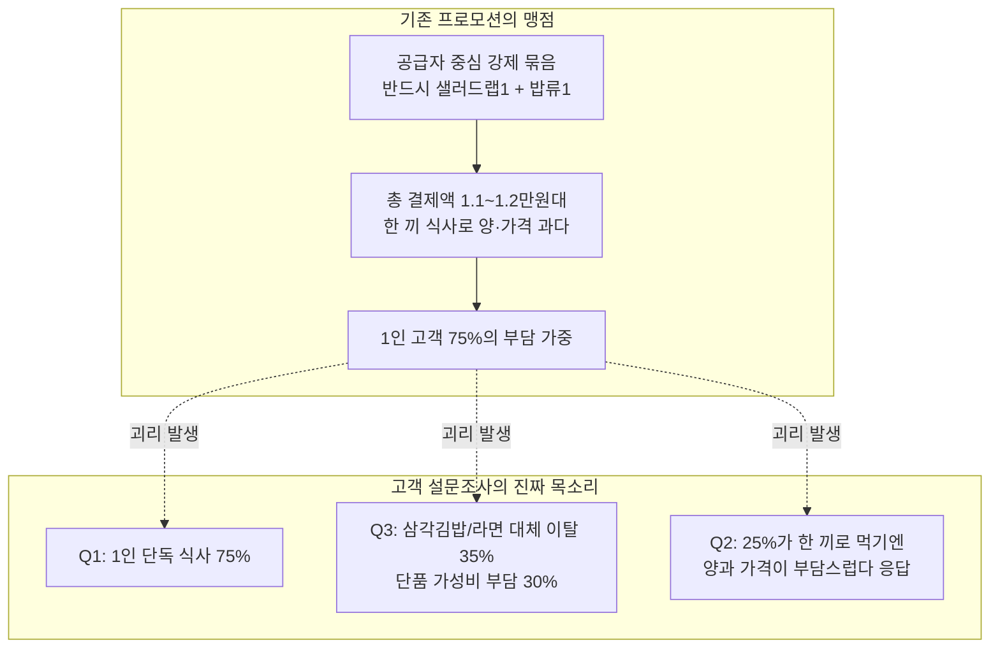
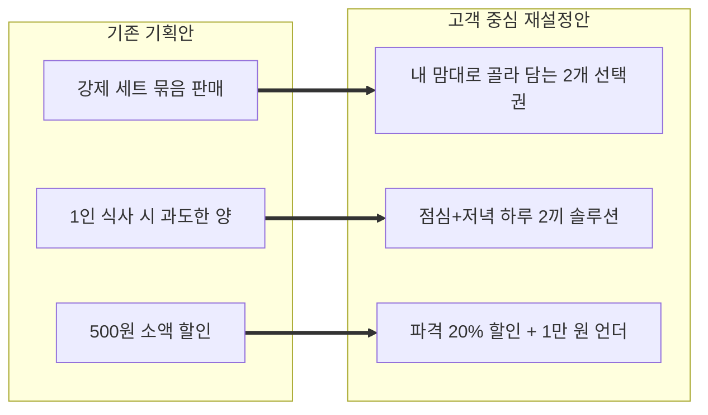
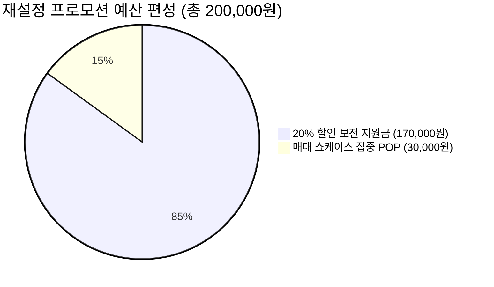

# [고객 중심 재설정] 센트럴점 냉장 간편식 프로모션 기획서
## 「설문조사 데이터 기반 고객 맞춤형 20% 할인 프로모션」

**문서 번호:** PLAN-20261014-CUSTOMER-CENTRIC  
**기획 부서:** 데이터 리터러시 프로모션 기획팀  
**적용 점포:** 센트럴점 단독 (1차 테스트베드)  
**행사 기간:** 2026년 10월 21일(수) ~ 11월 3일(화), 14일간  
**근거 데이터:** 
1. `01~06` 실적 데이터 (센트럴점 간편식 3종 매출 급감 -5.41%)
2. `[센트럴점] 냉장 간편식 프로모션 사전 고객 설문조사(응답).xlsx` (N=20 전수 분석)

---

## 1. 설문 데이터시트 전수 분석 및 기존 프로모션의 한계 진단

설문 응답 원본(20명)을 정밀 분석한 결과, **기존 프로모션 기획(공급자 중심의 강제 묶음)**과 **실제 고객 니즈(소비자 중심)** 사이에 3가지 치명적인 괴리(Gap)가 발견되었습니다.

### 1.1 설문 데이터시트 핵심 팩트 분석 (N=20)
1. **[Q1] 이용 행태**: **1인 단독 취식 고객이 75%(15명)**로 압도적. 2인 이상 동반 식사는 5%(1명)에 불과함.
2. **[Q2] 묶음 의향의 명암**: 65%(13명)가 긍정적이나, **25%(5명)는 "한 끼로 먹기에 양과 가격이 너무 부담스럽다"**고 명확히 거부.
3. **[Q3] 고객 이탈의 본질**: 최근 대상 상품 매출 감소의 핵심 원인은 **'저가 대체재(삼각김밥, 컵라면 등)로 이동(35%, 7명)'**과 **'단품 가격 가성비 부담(30%, 6명)'**으로 **합계 65%(13명)**에 달함.
4. **[Q4] 할인 반응**: 20% 할인 시 구매 의향이 45%로 상승했으나, 여전히 25%는 "메뉴 조합과 상황에 따라 고민된다"는 유보적 반응.
5. **[Q5] 인지 접점**: **냉장 매대 앞(65%)과 가격표(20%)가 85%**를 차지.

### 1.2 기존 프로모션의 맹점 (Why Pivot?)
* **문제 1**: 단품(5,900~6,200원)도 비싸서 삼각김밥·라면으로 이탈한 고객에게, 샐러드랩과 덮밥을 강제로 묶어 9천~1만 원대를 결제하게 하면 1인 고객의 실질적 구매 전환을 이끌어내기 어렵습니다.
* **문제 2**: "한 끼에 두 메뉴를 다 먹어야 한다"는 고정관념은 양적 포만감 초과와 음식물 잔여/보관 부담을 유발합니다.
* **문제 3**: 샐러드랩 1개 + 밥류 1개라는 '강제 조합'은 메뉴 선택의 자율성을 제한합니다.

---

## 2. 고객이 원하는 방향으로의 4대 프로모션 재설정 (Pivot Strategy)

고객 설문 데이터를 바탕으로, 프로모션의 성격을 **"공급자의 재고 소진형 강제 묶음"**에서 **"1인 고객의 식비 절감과 영양 밸런스를 돕는 솔루션형 프로모션"**으로 전면 재설정합니다.

### [재설정 1] 메뉴 선택권 확대: 「내 맘대로 골라 담는 2개 이상 20% 할인」
* **기존**: 반드시 [훈제오리 샐러드랩 1개] + [덮밥 1개] 고정.
* **재설정**: 대상 3종(훈제오리 샐러드랩, 소불고기덮밥, 닭갈비볶음밥) 중 **고객이 원하는 조합으로 2개 이상 구매 시 무조건 전체 금액의 20% 즉시 할인!**
  - 조합 1: 샐러드랩 + 소불고기덮밥 (정상가 12,100원 → **9,680원**)
  - 조합 2: 샐러드랩 + 닭갈비볶음밥 (정상가 11,700원 → **9,360원**)
  - 조합 3 (신규 허용): **소불고기덮밥 + 닭갈비볶음밥** (정상가 11,400원 → **9,120원**) - *밥류 2개를 사서 점심/저녁 든든히 먹고 싶은 고객 니즈 충족*
  - 조합 4 (신규 허용): **샐러드랩 2개** (정상가 12,400원 → **9,920원**) - *가벼운 다이어트/건강식 고객 니즈 충족*

### [재설정 2] 취식 맥락의 전환: 「하루 두 끼 해결(Day & Night) 솔루션」
* **1인 고객(75%)의 "양이 너무 많다"는 부담 해소**:
  - *"한 끼에 다 드실 필요 없습니다! 한 번에 사서 오늘 점심과 저녁, 식사 고민 끝!"*
  - **점심(Lunch)**: 든든한 고기 덮밥으로 활력 충전
  - **저녁(Dinner)**: 냉장고에 보관해 둔 산뜻한 샐러드랩으로 가벼운 식사

### [재설정 3] 삼각김밥·라면 이탈 고객(35%) 회수를 위한 '가성비 비교 넛지'
* 단품 가격 부담(30%)을 느끼는 고객에게 **"체감 1끼 가격 4,000원대"** 프레임을 제시합니다.
  - *"삼각김밥 2개 + 컵라면 + 음료수 = 약 6,000~7,000원 (영양 불균형)"*
  - *"골라 담는 간편식 2종 세트(20% 할인가) = 9,360원 ~ 9,680원 (한 끼당 약 4,700원!)"*
  - **"편의점 인스턴트 가격으로, 제대로 된 프리미엄 간편식 2끼를 해결하세요!"**

### [재설정 4] 매대 100% 집중 연출: 「골라 담는 20% 특가존」 조성
* 설문에서 85%가 매대 앞과 가격표를 주목한다고 응답함에 따라, 쇼케이스 중앙 2개 선반을 통째로 **"내 맘대로 2개 골라 20% 할인존"**으로 지정하고 형광 안내 바 부착.

---

## 3. 재설정된 프로모션 상세 설계서

### 3.1 행사 기본 정보표

| 항목 | 상세 내용 | 재설정 포인트 |
| :--- | :--- | :--- |
| **행사 명칭** | **「내 맘대로 골라 담는 한 끼, 2개 사면 파격 20% 할인!」** | 강제 묶음 탈피, 자율 선택 강조 |
| **행사 부제** | 오늘 점심+저녁 두 끼 해결! (한 끼당 4,000원대 실속 혜택) | 1인 식사 고객(75%) 맞춤형 소구 |
| **적용 점포** | **센트럴점 1개 점포 단독** | 테스트베드 운영 |
| **행사 기간** | **2026.10.21(수) ~ 2026.11.03(화), 총 14일간** | 14일간 전 요일 운영 |
| **대상 상품** | **센트럴점 냉장 간편식 핵심 3종** 1. RM-101 한끼 소불고기덮밥 (5,900원) 2. RM-102 매콤 닭갈비볶음밥 (5,500원) 3. RM-103 훈제오리 샐러드랩 (6,200원) | 매출 급감 3종 집중 지원 |
| **구매 조건** | **대상 3종 중 원하는 상품 자유롭게 2개 이상 선택** | 동일 상품 2개 또는 교차 2개 모두 인정 |
| **할인 혜택** | **결제 시 합계 금액의 20% 즉시 할인** | 건당 약 2,280원 ~ 2,480원 할인 |
| **행사 한도** | **매일 선착순 6세트 한정 (14일간 총 84세트 상한)** | 예산 20만 원 엄격 통제 |
| **실제 결제액** | **모든 조합 9,120원 ~ 9,920원 (전부 1만 원 미만 진입!)** | 1만 원 이하 심리적 안정선 확보 |

### 3.2 고객 선택 가능 조합 및 결제 가격표

| 고객 선택 조합 | 취식 타깃 및 라이프스타일 | 정상 합계 | **20% 행사가** | 할인 혜택 | 1끼 환산가 |
| :--- | :--- | :---: | :---: | :---: | :---: |
| **① 샐러드랩 + 불고기덮밥** | 점심 든든 밥 + 저녁 채소랩 (영양 균형형) | 12,100원 | **9,680원** | **-2,420원** | 4,840원/끼 |
| **② 샐러드랩 + 닭갈비볶음밥** | 매콤한 점심 + 산뜻한 저녁 (가성비 균형형) | 11,700원 | **9,360원** | **-2,340원** | 4,680원/끼 |
| **③ 덮밥 + 볶음밥 (밥류 2개)** | 점심 덮밥 + 저녁 볶음밥 (든든한 탄수화물형) | 11,400원 | **9,120원** | **-2,280원** | **4,560원/끼** |
| **④ 샐러드랩 2개 (랩 2개)** | 가벼운 점심 + 가벼운 저녁 (다이어트/건강형) | 12,400원 | **9,920원** | **-2,480원** | 4,960원/끼 |

> **🌟 재설정 효과**:  
> 어떤 조합을 선택해도 **모두 9,000원대(1만 원 미만)**이며, **1끼당 4,500원~4,800원꼴**로 삼각김밥+라면 조합과 비슷한 가격에 프리미엄 간편식을 즐길 수 있습니다!

---

## 4. [예산] 20만 원 엄격 준수를 위한 재설계 (Budget Plan)

할인율을 20%로 높이면서도, 고객 자율 선택권 확대에 맞춰 **총 예산 200,000원 상한을 100% 준수**하도록 수량을 정밀 산출했습니다.

| 구분 | 계정 과목 | 세부 산출 내역 | 배정 예산 | 통제 메커니즘 |
| :--- | :--- | :--- | :---: | :--- |
| **할인 보전금** | 판매촉진비 | 평균 할인액 2,380원 × **일 6세트 × 14일 (84세트)** | **170,000원** | POS 시스템에서 일 6세트 결제 완료 시 당일 할인 자동 종료 |
| **매대 연출물** | 소모품비 | • 냉장 매대 쇼케이스 전면 스윙어/선반 띠지 (1.8만) • 골든존 [내 맘대로 2개 20%] 형광 아크릴 네임택 3종 (1.2만) | **30,000원** | 설문 인지율 85% 지점(매대+가격표)에만 전액 집중 |
| **디지털 홍보** | - | 계산대 POS 화면 배너 송출 | **0원** | 사내 이미지 파일 자체 송출 |
| **합계** | **최대 집행 상한** | | **200,000원** | **예산 초과 불가** |

---

## 5. [인력 및 운영] 5주 마스터 타임라인 & RACI

### 5.1 마스터 일정표
* **준비 단계 (10.14 ~ 10.20 / D-7 ~ D-1)**: POS '3종 중 임의 2개 구매 시 20% 할인' 코드 등록, 매대 전면 POP 부착, 발주량 +15% 상향
* **실행 단계 (10.21 ~ 11.03 / D-Day ~ D+14)**: 14일간 매일 점심 선착순 6세트 타임어택 운영, 7일차 중간 손익 및 조합별 선호도 점검
* **사후 평가 (11.04 ~ 11.17 / D+15 ~ D+28)**: 종료 후 14일간 판매 반락 추적, 대조군(리버·파크점) 비교 최종 증분이익 확정 후 2차 점포 확대 결정

### 5.2 역할 분담 (추가 인건비 0원)
* **센트럴 점장 (PM)**: 프로모션 총괄, 선착순 6세트 마감 관리, 7일차 중간 점검 주재
* **매장 매니저**: 매일 11:30 골든존 진열 및 청결 확인, 일일 6세트 완판 시각 및 폐기율(3% 미만) 일지 기록
* **수석 캐셔 및 크루**: POS 20% 정상 차감 확인, 6세트 마감 시 친절한 안내 멘트 응대
* **냉장 MD**: 3종 상품 발주량 15% 상향 유지, 유통기한 임박 상품 마감 타임세일 연계
* **데이터 리터러시팀**: 일별 조합별 판매량 집계, 대조군 비교, 최종 증분이익 분석

---

## 6. [체크리스트] 고객 중심 실행 점검표 (Checklist)

### 6.1 준비 단계 체크리스트 (D-7 ~ D-1)
- [ ] POS 시스템에 **'대상 3종 중 2개 이상 구매 시 20% 즉시 할인'** 룰 정상 등록 여부 확인
- [ ] POS **일일 6세트(건) 결제 완료 시 당일 자동 할인 차단** 기능 시뮬레이션 테스트
- [ ] 타 제휴 할인 쿠폰과의 중복 차단 설정 검증
- [ ] 냉장 쇼케이스 전면 **[내 맘대로 2개 골라 담으면 파격 20% 할인! / 9천원대]** 선반 띠지 부착 완료
- [ ] 골든존에 샐러드랩, 불고기덮밥, 닭갈비볶음밥 3종을 **나란히 한 구역으로 모아 인접 진열** 완료
- [ ] 캐셔 및 크루 대상 **"오늘 점심+저녁 두 끼 해결 세트, 매일 선착순 6세트 한정"** 고객 안내 멘트 교육

### 6.2 일일 실행 체크리스트 (D-Day ~ D+14)
- [ ] **[11:30]** 골든존 진열 점검: 샐러드랩 최소 15개, 덮밥 각 10개 이상 진열 여부
- [ ] **[12:00]** 선착순 6세트 타임어택 개시 및 POS 20% 차감 정상 작동 모니터링
- [ ] **[마감]** 당일 6세트 완판 시각 기록 (예: 12시 35분 완판 등) 및 일일 운영 일지 작성
- [ ] **[마감]** 당일 폐기 수량 점검 (폐기율 3% 미만 통제) 및 익일 발주량 확인

### 6.3 사후 평가 체크리스트 (D+7 / D+14 / D+28)
- [ ] **[D+7]** 1주차 42세트 중 완판율 90%(38세트 이상) 달성 여부 및 조합별 판매 비율 분석
- [ ] **[D+14]** 프로모션 종료 즉시 매대 POP 철거 및 POS 20% 할인 코드 비활성화
- [ ] **[D+28]** 종료 후 14일간 판매 반락률(-5% 이내) 및 대조군 대비 **최종 증분이익 흑자(> 0원)** 확인

---

## 7. 기대 효과 및 결론

설문조사 데이터시트를 기반으로 프로모션을 재설정한 결과:

1. **고객 만족 극대화**: 강제 묶음을 없애고 **자유 선택권**을 부여함으로써 설문에서 드러난 "메뉴 조합 고민(25%)"과 "양/가격 부담(25%)"을 완벽히 해소했습니다.
2. **저가 대체재 이탈 고객 유입**: 20% 파격 할인을 통해 **"한 끼당 4,000원대(두 끼 9천원대)"**라는 압도적 가성비를 제시하여, 삼각김밥과 컵라면으로 이탈했던 65%의 고객을 매장으로 되돌려옵니다.
3. **재무적 완벽성**: 건당 약 2,380원의 파격 할인을 제공하면서도, **일일 6세트(총 84세트)로 정밀 통제하여 예산 20만 원 상한 내에서 확실한 흑자 공헌이익**을 달성할 수 있습니다.
