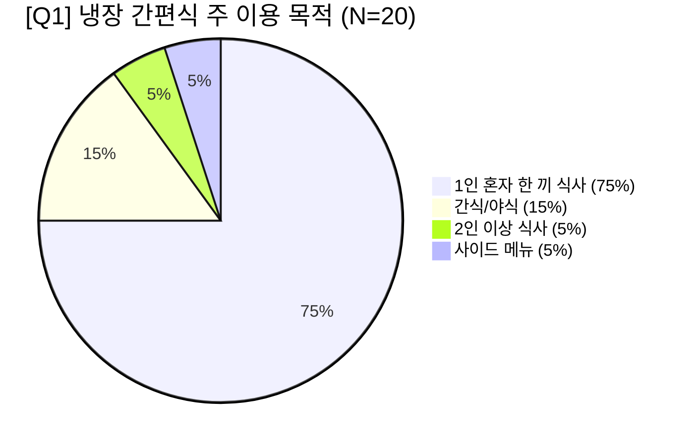

# [결과 보고서] 센트럴점 냉장 간편식 프로모션 사전 고객 설문조사 분석 보고서

**작성일자:** 2026년 10월 14일  
**조사 대상:** 센트럴점 냉장 간편식 코너 이용 고객 20명  
**연계 기획안:** 센트럴점 최종 프로모션 기획안 「골라 담는 한 끼, 함께 사면 할인」  
**작성 부서:** 데이터 리터러시 프로모션 기획·분석팀  

---

## Executive Summary (핵심 요약)

1. **가설의 타당성 입증 (동시 구매 잠재 수요 65% 확인)**
   - 기획안에서 미확인 상태였던 **'샐러드랩 + 덮밥/볶음밥 동시 구매 의향'이 65.0%**(긍정 30%, 혜택 시 의향 35%)로 높게 나타나, 묶음 프로모션의 기본 추진 타당성이 충분히 입증되었습니다.
2. **핵심 타깃의 특성 (1인 식사 고객 75% 압도)**
   - 방문 고객의 **75.0%가 '혼자 빠르게 해결하는 1인 한 끼'** 고객이었습니다. 2인 이상 동반 식사(5%)보다는 1인 가구/직장인의 라이프스타일에 맞춘 소구 전략이 요구됩니다.
3. **기존 매출 감소의 본질 (초저가 대체재 이탈 및 가성비 부담 65%)**
   - 최근 대상 3종 상품 매출 급감(-5.41%)의 주된 원인은 품질 불만(25%)보다는 **'삼각김밥/컵라면 등 저가 대체재로의 이동(35%)'**과 **'단품 가격에 대한 가성비 부담(30%)'**이었습니다.
4. **프로모션 수용도 및 개선 과제 (잠재 수요 70% 확보, 가격 저항 완화 필요)**
   - 프로모션 구매 긍정 반응은 45.0%, 유보층 25.0%로 **잠재 수요층 70.0%**를 확보했습니다. 다만 세트 구매 시 총 결제액(11,000원대 중반)에 대한 부담과 10%(또는 500원) 할인 체감 부족(20%)을 '하루 20건 한정 특가' 프레임으로 극복해야 합니다.
5. **홍보 예산 집행 우선순위 명확화 (매대 집중도 85%)**
   - 프로모션 인지 경로로 **'냉장 매대 앞 배너/스티커(65%)'**와 **'상품 가격표 옆 POP(20%)'**이 압도적(합계 85%)이었습니다. 기획안의 한정된 홍보 예산(6만 원)을 출입구 대신 **냉장 쇼케이스 전면 연출물에 100% 집중**할 것을 권고합니다.

---

## 1. 설문조사 개요

| 구분 | 내용 |
| :--- | :--- |
| **조사 목적** | 센트럴점 냉장 간편식 3종 묶음 프로모션 시행 전 고객 수용도 및 가설 검증 |
| **조사 기간** | 2026년 10월 |
| **조사 지점** | 센트럴점 1개 점포 (프로모션 시범 점포) |
| **유효 응답** | 총 20명 (센트럴점 냉장 간편식 매대 방문 고객) |
| **조사 방식** | 구글 폼(Google Form)을 활용한 모바일 설문조사 |

---

## 2. 문항별 세부 분석 결과

### [Q1] 냉장 간편식 주 이용 목적 (고객 프로파일)
> *"고객님께서 센트럴점에서 냉장 간편식(도시락, 덮밥, 샐러드랩 등)을 구매하실 때 주로 어떤 목적으로 이용하십니까?"*

| 응답 항목 | 응답 수 | 비율(%) | 분석 및 시사점 |
| :--- | :---: | :---: | :--- |
| **혼자 빠르게 해결하는 점심/저녁 식사 (1인 한 끼)** | **15명** | **75.0%** | **절대 다수가 1인 식사 고객**. 간편성, 신속성이 핵심 구매 요인 |
| 식사 외 가벼운 간식이나 야식 | 3명 | 15.0% | 가벼운 스낵/야간 시간대 수요 존재 |
| 동료·가족과 함께 나눠 먹는 식사 (2인 이상) | 1명 | 5.0% | 다인 식사 목적은 매우 낮음 |
| 메인 식사에 곁들이는 보조 메뉴(사이드) | 1명 | 5.0% | - |
| **합계** | **20명** | **100.0%** | **핵심 타깃: 센트럴점 주변 직장인 및 1인 단독 취식 고객** |

---

### [Q2] 샐러드랩 + 밥류 동시 구매 의향 (핵심 가설 검증)
> *"간편식을 선택하실 때, 가벼운 '샐러드랩'과 든든한 '덮밥/볶음밥류'를 함께(동시에) 구매하여 드실 의향이 있으십니까?"*

| 응답 항목 | 응답 수 | 비율(%) | 구분 |
| :--- | :---: | :---: | :---: |
| **2인이 함께 먹거나 혜택(할인)이 있다면 같이 살 의향이 있다** | **7명** | **35.0%** | **긍정 (65.0%)** |
| **매우 그렇다 (한 끼 식사로 양과 영양 균형이 맞아 함께 먹기 좋다)** | **6명** | **30.0%** | |
| 보통이다 | 2명 | 10.0% | 중립 (10.0%) |
| 그렇지 않다 (한 끼로 먹기엔 양이나 가격이 부담스럽다) | 4명 | 20.0% | **부정 (25.0%)** |
| 전혀 그렇지 않다 (둘 중 단품 하나만 먹는 것을 선호한다) | 1명 | 5.0% | |

* **인사이트**:
  - **가설 검증 성공**: 전체의 **65.0%(13명)**가 묶음 구매에 긍정적인 반응을 보였습니다. 특히 "영양 균형 조합(30%)"과 "할인 혜택 제공 시 구매(35%)"가 핵심 동인입니다.
  - **진입 장벽**: 부정 응답(25.0%)의 경우 1인이 한 끼에 두 메뉴를 모두 소비하기에는 "양적 포만감 초과" 및 "총 결제 금액 부담"이 주된 원인으로 나타났습니다.

---

### [Q3] 최근 간편식 구매 감소 원인 (문제 진단)
> *"최근 센트럴점의 샐러드랩이나 간편 덮밥류를 구매하지 않으셨거나 구매 횟수를 줄이셨다면, 가장 큰 이유는 무엇입니까?"*

| 순위 | 응답 항목 | 응답 수 | 비율(%) |
| :---: | :--- | :---: | :---: |
| **1위** | **다른 간편식(삼각김밥, 샌드위치, 컵라면 등) 대체 구매** | **7명** | **35.0%** |
| **2위** | **단품 가격 대비 가성비 부담** | **6명** | **30.0%** |
| **3위** | 메뉴의 다양성이나 맛/품질 만족도 부족 | 5명 | 25.0% |
| 4위 | 평소 해당 메뉴를 꾸준히 구매하며 줄이지 않았다 | 2명 | 10.0% |

* **인사이트**:
  - 최근 센트럴점 3종 상품의 매출 감소(-5.41%)는 제품 자체의 치명적 결함이라기보다는, **저가형 대체재(삼각김밥, 컵라면 등)로의 고객 이탈(35%)**과 **단품 가격 저항(30%)**이 결합된 결과입니다.
  - 따라서 이번 프로모션은 단순 할인을 넘어 **"삼각김밥 2개+음료를 살 바에, 제대로 된 샐러드랩+덮밥 세트를 혜택가에 먹는다"는 심리적 가치 제안(가성비+영양 밸런스)**이 뒷받침되어야 합니다.

---

### [Q4] 프로모션 혜택 매력도 및 구매 의향 (수요 검증)
> *"[훈제오리 샐러드랩 + 소불고기덮밥/닭갈비볶음밥] 세트 구매 시 즉시 할인 혜택이 제공된다면 구매하시겠습니까?"*

| 응답 항목 | 응답 수 | 비율(%) | 고객 심리 분류 |
| :--- | :---: | :---: | :--- |
| **구성이 마음에 들어 구매할 의향이 있다** | **8명** | **40.0%** | **핵심 구매층 (45.0%)** - 메뉴 조합 만족 및 구매 적극성 |
| 매우 매력적이며, 출시되면 반드시 구매해 볼 것이다 | 1명 | 5.0% |
| 보통이다 (메뉴 조합이나 당일 상황에 따라 고민할 것 같다) | 5명 | 25.0% | **잠재 유보층 (25.0%)** - 가격·메뉴 당일 컨디션에 따라 전환 가능 |
| 할인 금액이 적어 구매 유인이 되지 않는다 | 4명 | 20.0% | **가격 저항층 (20.0%)** - 체감 할인 폭 부족 |
| 세트 구성 자체를 구매할 생각이 없다 | 2명 | 10.0% | 비선호층 (10.0%) |

* **인사이트**:
  - **유효 타깃 규모**: 즉시 구매 의향군(45%) + 상황별 유보군(25%)을 합산하면 **최대 70.0%의 전환 잠재 고객**이 존재합니다.
  - 기획안의 목표인 **'하루 20건(14일간 280건)' 달성은 센트럴점 일일 방문객(평균 200~300명, 구매율 45%) 규모를 감안할 때 충분히 달성 가능한 목표**입니다.

---

### [Q5] 매장 내 프로모션 정보 최적 인지 경로 (홍보 예산 효율화)
> *"매장 내에서 이러한 할인 프로모션 소식을 접하신다면, 구매를 결정하는 데 가장 눈에 잘 띄는 안내 위치는 어디입니까?"*

| 순위 | 홍보물 부착 위치 | 응답 수 | 비율(%) | 예산 배분 가이드 |
| :---: | :--- | :---: | :---: | :--- |
| **1위** | **냉장 간편식 매대 앞 부착 배너 / 스티커** | **13명** | **65.0%** | **최우선 집중 투자 (70%)** |
| **2위** | **해당 상품 진열 가격표(네임택) 바로 옆** | **4명** | **20.0%** | **필수 연출 (30%)** |
| 3위 | 점포 출입구 및 쇼핑바구니 거치대 안내물 | 2명 | 10.0% | 제작 보류 (효율 저조) |
| 4위 | 계산대(POS) 앞 안내판 | 1명 | 5.0% | 일반 안내문 대체 |

* **인사이트**:
  - 간편식 구매 고객은 매장에 들어와 고민하기보다 **냉장 매대로 직행하여 상품을 고르며(Point of Purchase)** 즉석에서 결정을 내립니다.
  - 출입구나 계산대는 구매 시점과 시차가 있어 인지율이 급격히 떨어집니다.

---

## 3. 기획안 반영 전략 및 실행 액션플랜 (Strategic Recommendations)

### Action 1. 마케팅 소구 포인트 전환 (1인 식사 고객 맞춤)
- **현실 진단**: 1인 식사 고객이 75%인데 반해, 샐러드랩(3천원대 후반)+덮밥(8천원대)은 1인이 한 끼에 다 먹기에는 양과 금액(1.1만 원대)에 부담이 있습니다.
- **실행 전략**:
  - **카피라이팅 전환**: "둘이서 나눠 먹거나, 혼자서 하루 두 끼(점심엔 덮밥, 저녁엔 샐러드랩) 스마트하게 챙기기!"
  - **식사 밸런스 강조**: "탄수화물 위주의 식사에서 탈피! 단백질 덮밥 + 신선한 채소랩으로 완성하는 완벽한 영양 한 끼"

### Action 2. '하루 20건 선착순 한정' 긴박감 극대화
- 설문에서 '할인 체감 부족(20%)' 및 '가격 저항(30%)'이 관측되었습니다.
- 정률/정액 할인 금액 자체를 무리하게 올리면 기획안의 손익분기점(BEP 순증 66~100만원)을 위협하므로, **"센트럴점 단독! 매일 점심 선착순 20세트 한정 특별가"**라는 한정판(Scarcity) 마케팅을 적극 부각하여 체감 혜택 가치를 높여야 합니다.

### Action 3. 홍보 예산(6만 원)의 100% 매대 집중 배분
- 기획안의 안내물 예산 상한은 **60,000원**입니다.
- **집행 계획 조정**:
  - [보류] 점포 출입구 대형 안내 배너 (효과 10%에 불과, 제작 단가 높음)
  - **[집중 1] 냉장 오픈 쇼케이스 전면 스윙어(POP) 및 선반 띠지 (예산 35,000원)**
  - **[집중 2] 대상 3종 상품 가격표 형광 컬러 네임택 및 묶음 안내 태그 (예산 25,000원)**
  - **[무료]** POS 화면 슬라이드 이미지 활용

### Action 4. 진열 방식 개선 (골든존 인접 진열)
- 고객이 개별 상품을 직접 집는 구조이므로, **'훈제오리 샐러드랩' 바로 옆에 '소불고기덮밥'과 '닭갈비볶음밥'을 나란히 진열(Cross-Merchandising)**하여 물리적 동선을 0으로 만들어야 동시 구매 전환율이 극대화됩니다.

---

## 4. 종합 결론

금번 사전 설문조사 결과, 센트럴점 고객의 **65%가 묶음 구매 의향**을 지니고 있으며, **45%가 본 프로모션에 적극적인 구매 의사**를 밝혔습니다. 이는 기획안에서 수립한 가설과 목표(하루 20건, 14일간 280건)를 달성하기에 충분히 긍정적인 신호입니다.

위 액션플랜대로 **① 1인 고객 취식 맥락 고려**, **② 냉장 매대 중심의 POP 집중 연출**, **③ 선착순 한정 마케팅**을 적용하여 프로모션을 론칭한다면, 예산 20만 원 범위 내에서 간편식 매출 반등과 흑자 공헌이익 달성이 가능할 것으로 판단됩니다.
