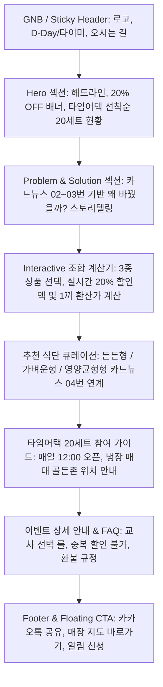
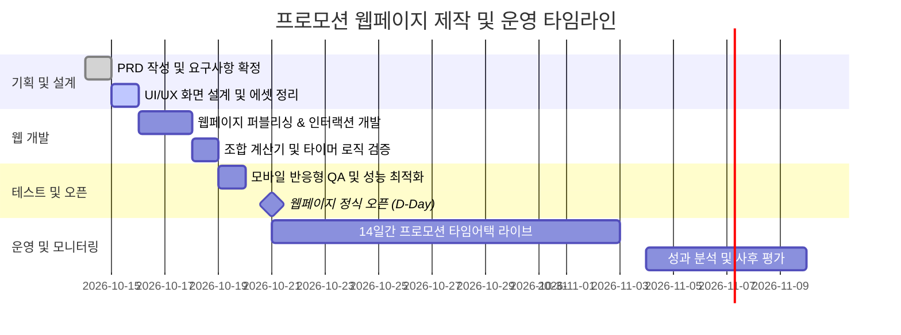

# [PRD] 이마트 센트럴점 간편식 20% 할인 프로모션 웹페이지 제품 요구사항 정의서
**Document Version:** v1.0.0  
**Status:** Approved / Ready for Dev  
**Date:** 2026년 10월 15일  
**Target Event Date:** 2026.10.21(수) ~ 2026.11.03(화) (14일간)  
**Author:** 프로모션 기획 및 프로덕트 기획팀  
**Related Documents:** 
- [센트럴점_최종_프로모션_실행기획안.md](file:///c:/Users/user/Desktop/%EB%8D%B0%EC%9D%B4%ED%84%B0%20%EB%A6%AC%ED%84%B0%EB%9F%AC%EC%8B%9C/%EA%B3%BC%EC%A0%9C%EB%8D%B0%EC%9D%B4%ED%84%B0/%EC%84%BC%ED%8A%B8%EB%9F%B4%EC%A0%90_%EC%B5%9C%EC%A2%85_%ED%94%84%EB%A1%9C%EB%AA%A8%EC%85%98_%EC%8B%A4%ED%96%89%EA%B8%B0%ED%9A%8D%EC%95%88.md)
- [센트럴점_최종_프로모션_실행기획서.pdf](file:///c:/Users/user/Desktop/%EB%8D%B0%EC%9D%B4%ED%84%B0%20%EB%A6%AC%ED%84%B0%EB%9F%AC%EC%8B%9C/%EA%B3%BC%EC%A0%9C%EB%8D%B0%EC%9D%B4%ED%84%B0/%EC%84%BC%ED%8A%B8%EB%9F%B4%EC%A0%90_%EC%B5%9C%EC%A2%85_%ED%94%84%EB%A1%9C%EB%AA%A8%EC%85%98_%EC%8B%A4%ED%96%89%EA%B8%B0%ED%9A%8D%EC%84%9C.pdf)
- 디자인 에셋: 포스터(`간편식 20% 할인 이벤트.png`), 카드뉴스 6종(`image (1) (1).png`, `2번.png`~`6번.png`)

---

## 1. 프로젝트 개요 및 배경 (Executive Summary)

### 1.1 배경 및 추진 동기
* **데이터 기반 문제 발견**: 이마트 센트럴점의 전체 매출은 성장세(+1.28%)였으나 냉장 간편식 카테고리는 역성장(-1.60%)하였으며, 특히 주력 3종 상품(샐러드랩, 불고기덮밥, 닭갈비볶음밥) 매출이 -5.41% 급감함.
* **고객 설문조사(N=20) 핵심 발견**:
  1. 이용객의 **75%가 1인 단독 식사(혼밥족)**.
  2. 고객 이탈 원인의 **65%가 저가 대체재(삼각김밥, 컵라면 35%) 이동 및 단품 가격 가성비 부담(30%)**.
  3. 기존 '공급자 중심 강제 묶음(샐러드랩 1 + 덮밥 1, 1.1~1.2만원)'은 1인 고객에게 양과 가격 모두 과도한 부담을 줌.
* **프로모션 피벗(Pivot)**: 고객이 원하는 메뉴 2종을 자유롭게 골라 담는 **「내 맘대로 2개 골라 20% 즉시 할인」**으로 전환. 하루 2끼(점심+저녁) 솔루션을 제공하여 전 조합 1만 원 미만(9천원대), **1끼당 4,000원대 실속 실현**.
* **[중요 변경사항 반영]**:
  - 기존 기획서 초안의 "일일 선착순 6세트" 한정 조건을 실전 카드뉴스 및 포스터 기준인 **"매일 점심 12:00 선착순 20세트 한정" (14일간 총 280세트)**으로 수정 반영.

### 1.2 프로모션 웹페이지 제작 목적
1. **O2O 트래픽 전환**: 온라인/모바일 웹페이지를 통해 센트럴점 인근 직장인·1인 가구에게 이벤트를 직관적으로 알리고, **오프라인 매장(센트럴점 냉장 매대 골든존)으로의 방문을 유도**.
2. **참여 장벽 해소 및 흥미 유발**: '내 맘대로 조합 계산기(Interactive Price Calculator)'를 통해 본인이 선호하는 조합의 실시간 할인 가격(1끼당 4천원대 체감)을 시각적으로 확인.
3. **타임어택 긴장감 및 혜택 강조**: 매일 점심 12시 오픈되는 **선착순 20세트**의 카운트다운 타이머 및 알림받기 기능 제공.

---

## 2. 프로덕트 목표 및 핵심 성과 지표 (Goals & KPIs)

### 2.1 비즈니스 목표
* **오프라인 매장 방문 및 완판 달성**: 행사 기간(14일간) 매일 점심 12:00 선착순 20세트(총 280세트) 조기 완판.
* **핵심 3종 상품 매출 반등**: 대조 점포 대비 대상 상품군 매출 +10% 이상, 샐러드랩 판매량 +12% 신장.

### 2.2 웹페이지 핵심 성과 지표 (Web KPIs)
| 지표명 | 목표치 | 측정 방식 |
| :--- | :--- | :--- |
| **방문자 수 (UV)** | 행사 기간 총 10,000명 이상 | Google Analytics 4 (센트럴점 반경 타깃 홍보) |
| **인터랙션율 (조합 계산기 사용률)** | 랜딩 페이지 방문자의 45% 이상 | '조합 계산기' 내 상품 토글 클릭 이벤트 |
| **타임어택 알림 신청 / 캘린더 등록** | 일평균 50건 이상 (총 700건+) | '알림 예약' CTA 클릭 및 폼 제출 |
| **오프라인 길찾기/매장 위치 클릭** | 랜딩 페이지 방문자의 20% 이상 | '센트럴점 오시는 길' 네이버/카카오 지도 연동 클릭 |
| **소셜 공유(바이럴) 건수** | 1,000건 이상 | 카카오톡 공유하기 및 URL 복사 완료 이벤트 |

---

## 3. 타깃 사용자 정의 및 핵심 페르소나 (Target Audience)

### 3.1 주요 타깃층
* **Primary Target**: 센트럴점 인근 오피스/상업지구 2030 직장인 혼밥족 (점심 식비 부담을 느끼고 빠른 식사를 선호하는 1인 고객)
* **Secondary Target**: 매장 인근 오피스텔 거주 1인 자취생 및 다이어트/건강 식단을 추구하는 가성비 스마트 컨슈머

### 3.2 핵심 사용자 페르소나 (Persona)
* **이름 / 연령**: 김민우 (29세, 센트럴점 인근 IT 스타트업 개발자, 1인 가구)
* **Pain Point**:
  - 점심 외식 물가가 1만 원을 훌쩍 넘어 삼각김밥이나 편의점 라면으로 때우는 날이 많아 영양 불균형이 걱정됨.
  - 마트 간편식 세트는 양이 너무 많거나 내가 원하지 않는 메뉴가 묶여 있어 구매가 망설여짐.
* **Needs & Goal**:
  - 점심에는 든든하게 덮밥을 먹고, 저녁에는 가볍게 샐러드랩을 먹을 수 있도록 점심시간에 한 번에 사두고 싶음.
  - 1만 원 한 장으로 하루 두 끼(점심+저녁)를 고품질로 해결하고 싶음.

---

## 4. 정보 구조 (Information Architecture - IA)

웹페이지는 단일 페이지(One-page Responsive Web) 형태로 스크롤 흐름에 따라 사용자의 흥미 유발부터 구매 행동 유도까지 자연스럽게 연결합니다.

---

## 5. 상세 기능 요구사항 정의 (Functional Requirements)

### 5.1 [Section 1] GNB & Sticky Top Bar
* **FR-1.1 (브랜드 로고)**: 이마트 로고 및 프로모션 공식 마스코트 '고래잇' 심볼 노출.
* **FR-1.2 (타임어택 긴급성 표시)**: 상단에 얇은 배너 형태로 `[매일 점심 12:00 선착순 20세트 한정 20% OFF]` 텍스트 롤링/고정.
* **FR-1.3 (퀵 액션 네비게이션)**: `[혜택 계산기]`, `[추천 조합]`, `[매장 골든존 위치]` 앵커 스크롤 버튼 제공.

### 5.2 [Section 2] Hero 섹션 (Main Banner & 타임어택 카운트다운)
* **FR-2.1 (메인 카피 & 비주얼)**:
  - 메인 타이틀: **"오늘의 간편식, 내 맘대로 골라 담자!"**
  - 서브 타이틀: **"대상 상품 2개 이상 구매 시 20% 파격 할인 | 1끼당 4,000원대!"**
  - 메인 비주얼: 포스터(`간편식 20% 할인 이벤트.png`) 비주얼 요소를 모티브로 한 생생한 3종 상품 실사 누끼 + 고래잇 캐릭터.
* **FR-2.2 (점심 12:00 타임어택 카운트다운 타이머)**:
  - 현재 시각 기준, **당일 낮 12:00:00**까지 남은 시간(`HH:MM:SS`)을 실시간 역산하는 카운트다운 위젯.
  - 낮 12:00~14:00 사이에는 `🔥 지금 선착순 20세트 타임어택 진행 중! 매장으로 방문하세요!` 배너로 동적 전환.
* **FR-2.3 (선착순 20세트 게이지 바 & 잔여 수량 표시)**:
  - `매일 선착순 20세트 한정!` 강조 뱃지.
  - 시각적 프로그레스 바(Progress Bar) 표시: "오늘의 선착순 잔여 수량 [ 20 / 20 세트 준비완료 ]" (매장 방문 심리 자극).
* **FR-2.4 (알림 신청 CTA)**:
  - `[매일 11:50 타임어택 10분 전 알림받기]` 버튼 클릭 시 알림 예약 모달 팝업.

### 5.3 [Section 3] 고객 인사이트 & 피벗 스토리 (Why Story)
* **FR-3.1 (설문조사 데이터 시각화 - 카드뉴스 02번/03번 연계)**:
  - "왜 바꿨을까요? 센트럴점 고객 20명의 진짜 목소리에 귀 기울였습니다!"
  - 통계 카드 2개 대조:
    * `75%`: 혼밥족의 단독 식사 (혼자 빠르게 해결)
    * `65%`: 단품 가격 가성비 부담 및 삼각김밥/라면 이탈 고객
  - Pivot 전후 비교 인포그래픽:
    * **기존의 강제 묶음** (샐러드랩 1 + 덮밥 1 필수, 1.1만 원대) ➔ **내 맘대로 2종 자유 선택** (밥+밥, 랩+랩 모두 가능, 전 조합 9천원대).

### 5.4 [Section 4] 인터랙티브 '내 맘대로 조합 계산기' (Core Interactive Feature)
* **FR-4.1 (상품 선택 UI - 3종 상품 카드)**:
  사용자가 직접 상품 카드의 `+` / `-` 버튼을 눌러 원하는 수량을 담아볼 수 있는 시뮬레이터.
  1. **한끼 소불고기덮밥** (정상가: 5,900원 / 영양 든든 고기 토핑)
  2. **매콤 닭갈비볶음밥** (정상가: 5,500원 / 입맛 돋우는 매콤 소스)
  3. **훈제오리 샐러드랩** (정상가: 6,200원 / 신선한 채소와 훈제오리)
* **FR-4.2 (동적 계산 로직)**:
  - 선택한 상품의 총합이 **2개 이상**일 경우:
    * `정상 합계 금액` 계산
    * `20% 할인 금액` (-20%) 즉시 차감 계산
    * `최종 결제 예상가` (빨간색 볼드 강조)
    * `1끼 환산가` (최종 결제액 ÷ 총 선택 수량) 계산하여 **"한 끼당 약 0,000원!"** 뱃지 노출.
  - 선택 수량이 2개 미만일 경우:
    * "2개 이상 선택 시 20% 할인이 적용됩니다! (1개 더 골라보세요)" 안내 가이드 툴팁 출력.
* **FR-4.3 (원클릭 프리셋 버튼 - 4대 인기 조합 자동 세팅)**:
  - 버튼 클릭 한 번으로 수량이 자동 세팅되는 퀵 프리셋 제공:
    1. `[든든형 세트]`: 불고기덮밥(1) + 닭갈비볶음밥(1) ➔ **정상 11,400원 ➔ 9,120원 (1끼 4,560원)**
    2. `[가벼운형 세트]`: 샐러드랩(2) ➔ **정상 12,400원 ➔ 9,920원 (1끼 4,960원)**
    3. `[영양균형형 A]`: 샐러드랩(1) + 불고기덮밥(1) ➔ **정상 12,100원 ➔ 9,680원 (1끼 4,840원)**
    4. `[영양균형형 B]`: 샐러드랩(1) + 닭갈비볶음밥(1) ➔ **정상 11,700원 ➔ 9,360원 (1끼 4,680원)**

### 5.5 [Section 5] 카드뉴스 큐레이션 & 라이프스타일 제안 (Day & Night)
* **FR-5.1 (카드뉴스 스와이프 뷰어 / 탭 UI - 카드뉴스 04번/05번 연계)**:
  - 고화질 카드뉴스 슬라이드(01~06)를 모바일 스와이프(Touch Swipe) 또는 좌우 화살표로 탐색 가능.
* **FR-5.2 (하루 두 끼 해결 솔루션 스토리)**:
  - "한 끼에 다 드실 필요 없습니다! 점심은 덮밥으로 든든하게, 저녁은 샐러드랩으로 가볍게!"
  - 냉장 보관 팁 및 전자레인지 조리 가이드 아이콘 표기.

### 5.6 [Section 6] 매장 방문 가이드 & 오프라인 골든존 안내 (O2O 핵심)
* **FR-6.1 (오프라인 매장 정보)**:
  - 매장명: **이마트 센트럴점 지하 1층 신선/냉장 식품 코너**
  - 행사 장소: **간편식 쇼케이스 골든존 (중앙 2~3단)**
  - 매장 운영 시간: 10:00 ~ 22:00 (타임어택 시작: 매일 12:00 정각)
* **FR-6.2 (골든존 매대 찾는 법 비주얼 안내)**:
  - 매대 전면 형광 노란색 띠지 및 고래잇 아크릴 네임택 사진 안내.
  - "이마트 센트럴점 냉장 매대에서 노란색 [20% 할인존]을 찾아주세요!"
* **FR-6.3 (지도 연동 & 길찾기 CTA)**:
  - 네이버 지도, 카카오맵 길찾기 링크 버튼.
  - 매장 전화 연결 버튼 (`tel:051-...`).

### 5.7 [Section 7] 프로모션 세부 규정 & FAQ
* **FR-7.1 (FAQ 아코디언 컴포넌트)**:
  - Q1. 동일 상품으로만 2개를 사도 20% 할인이 되나요?  
    ➔ **A. 네! 샐러드랩 2개, 덮밥 2개 등 동일 상품으로 2개를 구매하셔도 동일하게 20% 할인이 적용됩니다.**
  - Q2. 선착순 20세트는 언제 마감되나요?  
    ➔ **A. 매일 낮 12:00부터 결제 순서대로 선착순 20건에 한해 포스(POS)에서 자동 20% 할인이 적용되며, 20세트 소진 시 당일 프로모션 할인은 자동 마감됩니다.**
  - Q3. 통신사 할인이나 다른 카드사 쿠폰과 중복 적용이 가능한가요?  
    ➔ **A. 본 행사는 파격 특가 프로모션으로, 타 제휴 할인 및 중복 할인은 불가합니다.**
  - Q4. 3개 이상 구매해도 할인이 적용되나요?  
    ➔ **A. 행사 대상 3종 상품에 한해 2개 이상 구매 시 전체 대상 상품 금액의 20%가 할인됩니다.**

### 5.8 [Section 8] 소셜 공유 및 플로팅 하단 바 (Floating Bottom Bar)
* **FR-8.1 (카카오톡 및 SNS 공유하기)**:
  - 카카오톡 공유 API 연동: "이마트 센트럴점 간편식 20% 할인! 매일 점심 12시 선착순 20세트!" 썸네일과 메시지 템플릿 전송.
  - 링크 복사(URL Copy) 기능 및 토스트 팝업 알림.
* **FR-8.2 (모바일 플로팅 하단 CTA)**:
  - 화면 스크롤 시 하단 고정 바 노출.
  - 좌측: `매일 12시 선착순 20세트!` 잔여 뱃지
  - 우측: `[센트럴점 매장 길찾기 📍]` 액션 버튼

---

## 6. 비기능적 요구사항 (Non-Functional Requirements)

### 6.1 성능 및 로딩 속도 (Performance)
* **초기 로딩 시간**: 모바일 4G LTE 환경 기준 LCP(Largest Contentful Paint) **1.8초 이내**.
* **이미지 최적화**: 포스터 및 카드뉴스 이미지는 WebP 포맷으로 변환 압축 및 `loading="lazy"` 속성 적용.
* **가벼운 번들 사이즈**: 프레임워크 오버헤드를 최소화하고 Vanilla HTML/CSS/JS 또는 경량 라이브러리 사용.

### 6.2 반응형 및 디바이스 호환성 (Responsiveness & Compatibility)
* **Mobile-First 디자인**: 유입 트래픽의 85% 이상이 모바일(스마트폰)일 것으로 예상되므로 모바일 뷰(360px ~ 430px)를 최우선 기준으로 레이아웃 설계.
* **지원 해상도**:
  - Mobile: 360px ~ 767px (단일 컬럼, 엄지 손가락 친화적 터치 타깃 최소 44x44px)
  - Tablet: 768px ~ 1023px (2컬럼 반응형 그리드)
  - Desktop: 1024px 이상 (최대 컨테이너 폭 720px~960px의 모바일 앱 뷰 컨테이너형 레이아웃 또는 풀와이드 레이아웃)
* **크로스 브라우징**: iOS Safari, Chrome Mobile, Samsung Internet, Kakao In-app Browser, Naver In-app Browser 완벽 호환.

### 6.3 SEO 및 메타 태그 최적화 (SEO & Social Sharing)
* **Title**: `[이마트 센트럴점] 간편식 20% 파격 할인 - 매일 점심 12시 선착순 20세트 타임어택!`
* **Meta Description**: `골라 담는 한 끼! 센트럴점 냉장 간편식 3종 중 원하는 2개를 고르면 20% 즉시 할인. 매일 낮 12시 선착순 20세트 한정, 1끼당 4천원대에 두 끼를 해결하세요!`
* **OpenGraph (OG Tags)**:
  - `og:image`: 메인 포스터(`간편식 20% 할인 이벤트.png`) 썸네일
  - `og:title`, `og:description` 설정 완료

### 6.4 보안 및 데이터 안정성
* HTTPS 보안 프로토콜 100% 강제.
* 알림 예약 신청 시 전화번호 암호화 저장 및 마케팅 활용 동의 필수 체크(개인정보보호법 준수).

---

## 7. 디자인 시스템 및 UI/UX 가이드라인 (Design System)

기존 제작된 포스터(`간편식 20% 할인 이벤트.png`)와 카드뉴스(6종)의 비주얼 아이덴티티를 100% 계승합니다.

### 7.1 컬러 팔레트 (Color Palette)
| 구분 | 색상 코드 | 용도 | 비주얼 레퍼런스 |
| :--- | :--- | :--- | :--- |
| **Brand Primary** | `#FFB800` (Emart Yellow) | 배경 포인트, 상단 헤더, 메인 CTA 버튼 | 포스터 노란색 배경 |
| **Brand Dark** | `#1A2530` / `#0F172A` (Navy/Charcoal) | 카드뉴스 배경, 텍스트 타이틀, 강조 박스 | 카드뉴스 03/04/06번 딥네이비 |
| **Accent Red** | `#E60012` / `#FF3B30` (Sale Red) | 20% OFF 파격 할인 뱃지, 타임어택 타이머, 가격 취소선 | 20% OFF 붓터치 뱃지 |
| **Sub Accent** | `#22C55E` / `#00C48C` (Fresh Mint) | 영양 균형, 샐러드랩 신선도 태그, 고래잇 캐릭터 서브 컬러 | 고래잇 지느러미 민트그린 |
| **Neutral White** | `#FFFFFF` | 상품 카드 배경, 정보 컨테이너 | 깔끔한 컨테이너 |
| **Text Main** | `#111827` (Gray-900) | 본문 텍스트, 가독성 최우선 | Pretendard Regular/Bold |

### 7.2 타이포그래피 (Typography)
* **Primary Font**: `Pretendard`, `-apple-system`, `BlinkMacSystemFont`, `sans-serif`
* **헤드라인**: `font-weight: 800 (ExtraBold)`, 자간 `-0.03em`, 임팩트 있는 큰 타이포
* **강조 가격 숫자**: `font-weight: 900 (Black)`, 가독성 높은 영문/숫자 폰트 병용

### 7.3 캐릭터 및 그래픽 에셋
* **고래잇 (Gorae-it)**: 이마트 센트럴점의 귀여운 노란색/하늘색 고래 캐릭터를 웹페이지 곳곳의 안내자(Helper/Guide)로 배치하여 친근하고 생동감 있는 분위기 연출.
* **배지 & 스티커**: `[매일 점심 12시]`, `[선착순 20세트]`, `[전 조합 9천원대]`, `[20% OFF]` 등 스티커 형태의 마이크로 비주얼 적용.

---

## 8. 조합별 가격 및 할인 공식 테이블 (Data Reference)

계산기 컴포넌트 및 UI 전반에 적용되는 정확한 가격 데이터입니다.

| 상품 ID | 상품명 | 카테고리 | 정상 단품가 | 특징 |
| :--- | :--- | :--- | :---: | :--- |
| **RM-101** | 한끼 소불고기덮밥 | 밥류 | 5,900원 | 달콤 짭조름한 소불고기와 든든한 쌀밥 |
| **RM-102** | 매콤 닭갈비볶음밥 | 밥류 | 5,500원 | 매콤한 닭갈비와 고소한 김가루의 조화 |
| **RM-103** | 훈제오리 샐러드랩 | 랩류 | 6,200원 | 참나무 훈제오리와 신선한 양상추, 또띠아 |

### 대표 4대 조합 가격 매트릭스 (20% 할인 적용 시)
| 번호 | 고객 선택 조합 | 정상 합계 | **20% 행사가** | 할인 절감액 | 1끼 환산가 | 비고 |
| :---: | :--- | :---: | :---: | :---: | :---: | :--- |
| **1** | **샐러드랩 + 불고기덮밥** | 12,100원 | **9,680원** | **-2,420원** | 4,840원/끼 | 영양 균형 (채소+고기) |
| **2** | **샐러드랩 + 닭갈비볶음밥** | 11,700원 | **9,360원** | **-2,340원** | 4,680원/끼 | 가성비 균형 |
| **3** | **불고기덮밥 + 닭갈비볶음밥** | 11,400원 | **9,120원** | **-2,280원** | **4,560원/끼** | **최저가 조합!** (든든 탄수화물) |
| **4** | **샐러드랩 2개** | 12,400원 | **9,920원** | **-2,480원** | 4,960원/끼 | **최대 할인액!** (식단 관리/다이어트) |

> **공통 혜택 포인트**: 4가지 조합 모두 **정상가 1.1~1.2만 원대 ➔ 전 조합 9천 원대 진입 (1만 원 언더)**, **1끼 환산가 4,000원대 중후반**.

---

## 9. 이벤트 운영 정책 및 예산 관리 기준 (Business Policy)

### 9.1 선착순 20세트 타임어택 운영 정책 (Updated!)
1. **행사 시간**: 행사 기간(10.21 ~ 11.03) 동안 **매일 낮 12:00:00부터 개시**.
2. **수량 제한**: **매일 선착순 20세트(건) 한정**.
   - 14일간 총 제공 세트: **280세트** (기존 6세트×14일=84세트에서 20세트로 확대).
3. **통제 메커니즘**:
   - 매장 POS 시스템에 "일일 20세트 결제 완료 시 20% 프로모션 할인 자동 마감 차단" 룰셋 적용.
   - 선착순 마감 이후 구매 고객에게는 현장 캐셔 안내 및 다음 날 점심 12:00 타임어택 안내.
4. **구매 제한**: 1인당 1회 결제 시 1세트(2개) 할인 적용 원칙 (사재기 방지).

---

## 10. 개발 및 릴리즈 로드맵 (Milestones)

---

## 11. 개발 스택 및 배포 권장 사양

* **Frontend**: HTML5, Vanilla CSS3 (현대적 CSS 변수, Flexbox, CSS Grid), Vanilla JavaScript (ES6+)
* **Styling Guide**: Modern Glassmorphism & High-Contrast CTA, 이마트 옐로우/네이비 톤앤매너
* **배포 환경**: Github Pages, Vercel, Netlify, 또는 사내 웹 서버 (정적 웹 호스팅 완벽 호환)
* **에셋 관리**: 작업 공간 내 고화질 원본 이미지 7종(`간편식 20% 할인 이벤트.png`, `image (1) (1).png`, `2번.png`~`6번.png`) 연동
